<p align="center">
  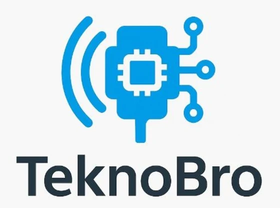
</p>

<h1 align="center">Manggot IoT</h1>
<p align="center">Monitoring dan kontrol inkubator larva BSF (manggot) berbasis ESP32, Firebase, aplikasi Android, dan web.<br>Dibuat oleh <b>TeknoBro</b></p>

<p align="center">
  <b>Web:</b> <a href="https://ptrfarhan.github.io/manggot-iot/">https://ptrfarhan.github.io/manggot-iot/</a> (HP dan desktop) &nbsp;·&nbsp; <b>Android:</b> <code>build-apk.bat</code>
</p>

<p align="center">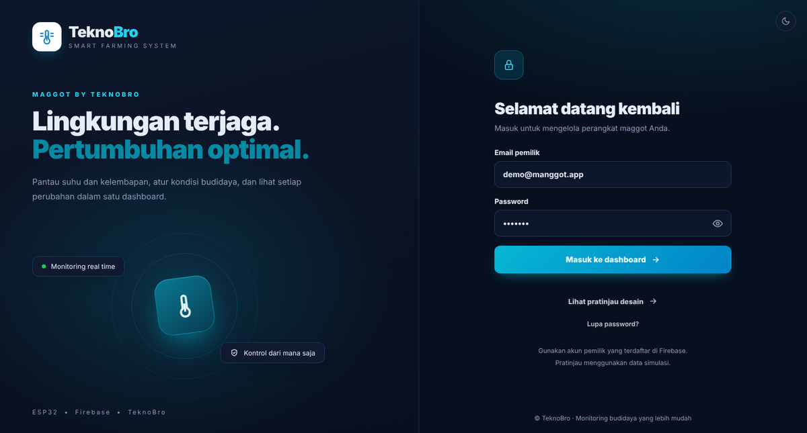</p>
<p align="center">
  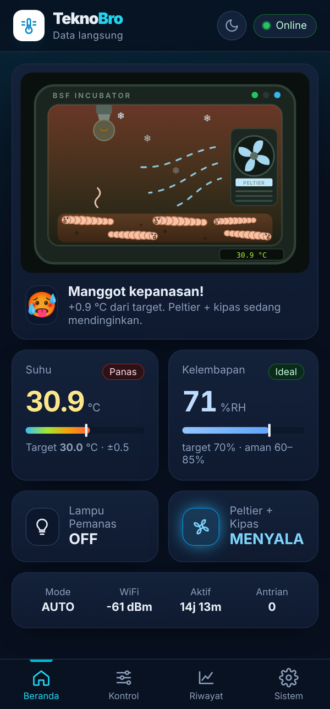
  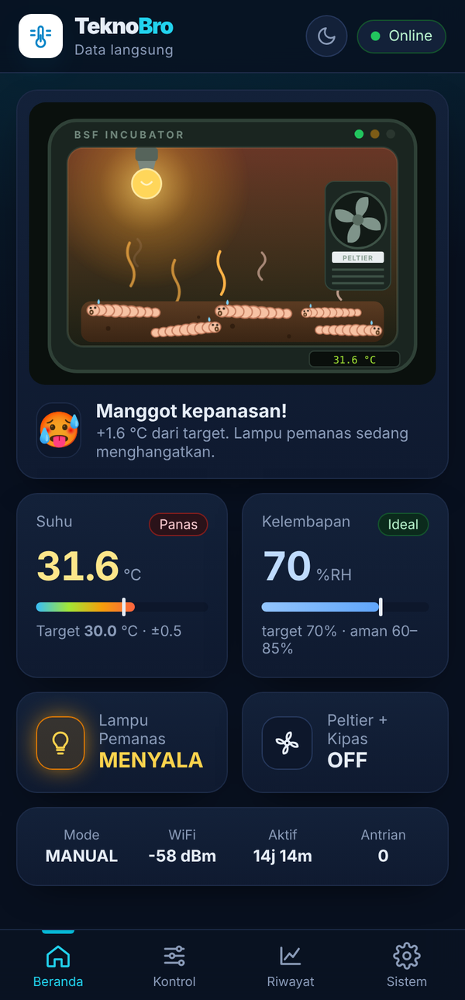
  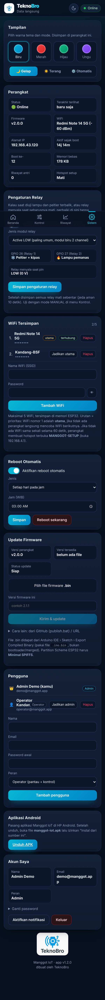
</p>

---

## Daftar isi
1. [Fitur](#1-fitur)
2. [Skematik dan pin mapping](#2-skematik-dan-pin-mapping)
3. [Cara kerja sistem](#3-cara-kerja-sistem)
4. [Tampilan aplikasi](#4-tampilan-aplikasi)
5. [Tampilan LCD](#5-tampilan-lcd-20x4)
6. [Struktur folder](#6-struktur-folder)
7. [Setup Firebase](#7-setup-firebase)
8. [Upload program ESP32](#8-upload-program-esp32)
9. [Build aplikasi Android (APK)](#9-build-aplikasi-android-apk)
10. [Publish ke GitHub](#10-publish-ke-github-sekali-klik)
11. [Update firmware (OTA)](#11-update-firmware-ota)
12. [Simulasi Wokwi](#12-simulasi-wokwi)
13. [Perintah Serial](#13-perintah-serial)
14. [Struktur database](#14-struktur-database)
15. [Masalah umum](#15-masalah-umum)

---

## 1. Fitur

| Bagian | Fitur |
|---|---|
| Kontrol suhu | Mode **AUTO** (histeresis terhadap target) dan **MANUAL** (nyalakan pemanas atau pendingin dari aplikasi) |
| Keamanan | Interlock (pemanas dan pendingin tidak pernah menyala bersamaan), jeda relay 10 detik, batas aman suhu di mode manual, semua relay mati jika sensor tidak terbaca lebih dari 10 detik |
| Kelembapan | Target RH ideal, batas peringatan RH minimum dan maksimum |
| Relay | **Tukar relay** (pemanas dan pendingin) dan **polaritas** (active LOW atau HIGH) dari aplikasi, tersimpan di memori |
| Memori | Semua setelan tersimpan di **Preferences/NVS** (EEPROM ESP32), tetap ada saat listrik padam |
| Riwayat | Disimpan dulu di flash **LittleFS** (sekitar 6000 data). Saat offline data ditahan, saat online dikirim ke cloud |
| WiFi | Maksimal 5 WiFi berprioritas. Jika WiFi utama tidak ada, langsung mencoba WiFi berikutnya. Hotspot terbuka **MANGGOT-SETUP** muncul jika 60 detik tanpa WiFi |
| Reboot | Reboot otomatis setiap N jam atau setiap hari pada jam tertentu, dan reboot dari aplikasi |
| Update firmware | OTA dari **file .bin yang dipilih di aplikasi**, dari GitHub, dari URL, atau dari halaman lokal 192.168.4.1 |
| Aplikasi | Android (APK) dan web (HP dan desktop), login multi pengguna (admin dan operator), animasi manggot, grafik, unduh CSV, log aktivitas, notifikasi |
| Tampilan | 4 warna tema (**biru, merah, hijau, ungu**) dan mode **gelap / terang / otomatis**, dipilih di Sistem › Tampilan |
| LCD 20x4 | Animasi boot, halaman bergantian, peringatan berkedip, progres update firmware |

---

## 2. Skematik dan pin mapping

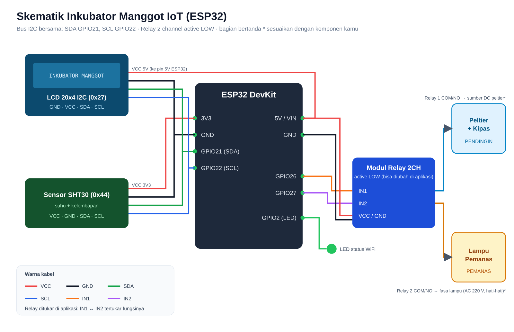

### Pin mapping

| Komponen | Pin komponen | Pin ESP32 | Keterangan |
|---|---|---|---|
| LCD 20x4 I2C | VCC | 5V / VIN | alamat I2C 0x27 |
| | GND | GND | |
| | SDA | GPIO 21 | bus I2C bersama |
| | SCL | GPIO 22 | bus I2C bersama |
| Sensor SHT30 | VCC | 3V3 | alamat I2C 0x44 |
| | GND | GND | |
| | SDA | GPIO 21 | |
| | SCL | GPIO 22 | |
| Modul relay 2 channel | IN1 | GPIO 26 | Relay 1 = **Peltier + kipas** (pendingin) |
| | IN2 | GPIO 27 | Relay 2 = **Lampu pemanas** |
| | VCC / GND | 5V / GND | modul active LOW (bisa diubah di aplikasi) |
| LED status | anoda (lewat resistor) | GPIO 2 | nyala = WiFi OK, kedip cepat = mencari WiFi, kedip lambat = hotspot setup aktif |

Kalau ternyata relay 1 dan relay 2 terbalik saat dipasang, tidak perlu bongkar kabel. Buka **Sistem › Pengaturan Relay** di aplikasi lalu aktifkan **Tukar relay**.

Catatan pemasangan:
* Beban di sisi kontak relay (COM/NO) menyesuaikan komponen yang dipakai. Sumber daya peltier dan kipas tidak ditentukan di proyek ini, jadi sesuaikan dengan spesifikasi peltier kamu.
* Jika lampu pemanas memakai listrik AC 220 V, pastikan kabel terisolasi dan relay sesuai rating arusnya.

---

## 3. Cara kerja sistem

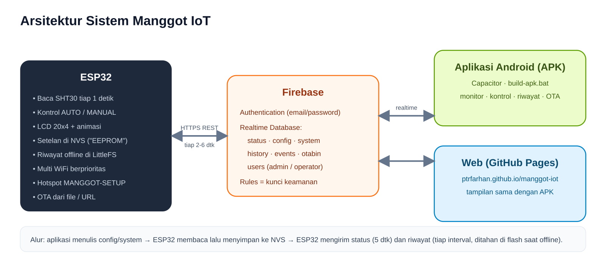

### Logika kontrol mode AUTO (contoh target 30 °C, histeresis 0,5 °C)

| Kondisi suhu | Aksi |
|---|---|
| suhu ≥ 30,5 °C | lampu dimatikan, **peltier + kipas menyala** |
| suhu ≤ 29,5 °C | peltier dimatikan, **lampu menyala** |
| 29,5 sampai 30,5 °C | aktuator tetap. Peltier mati kembali saat suhu ≤ 30 °C, lampu mati kembali saat suhu ≥ 30 °C |
| sensor error > 10 detik | semua relay mati (fail-safe) |

### Mode MANUAL
Pemanas dan pendingin dinyalakan dari aplikasi. Interlock tetap aktif. Pemanas diputus otomatis jika suhu melewati **batas aman pemanas**, dan pendingin diputus jika suhu di bawah **batas aman pendingin**.

### Alur data
1. Aplikasi menulis perubahan (target, mode, WiFi, relay) ke Firebase.
2. ESP32 membaca `config` setiap 2 detik dan `system` setiap 6 detik, lalu menyimpannya ke NVS.
3. ESP32 mengirim `status` setiap 5 detik, dan segera saat relay atau peringatan berubah.
4. Riwayat ditulis ke flash sesuai interval, lalu dikirim bertahap ke `history`. Saat offline, riwayat tetap tersimpan dan dikirim setelah online.

### Prioritas WiFi
1. WiFi nomor 1 di aplikasi adalah **utama**.
2. ESP32 memindai jaringan, mencoba WiFi yang terlihat sesuai urutan daftar, lalu WiFi lain yang mungkin tersembunyi.
3. Jika satu WiFi gagal dalam 12 detik, ESP32 langsung mencoba WiFi berikutnya.
4. Jika 60 detik tanpa WiFi sama sekali, hotspot **MANGGOT-SETUP** (tanpa password) aktif di `192.168.4.1` untuk menambah WiFi.

---

## 4. Tampilan aplikasi

Web bisa dibuka di **https://ptrfarhan.github.io/manggot-iot/**, dengan tata letak khusus untuk layar desktop (login dua kolom, beranda dua kolom, menu di atas) dan HP (menu di bawah). Tombol **Lihat pratinjau desain** di halaman login membuka aplikasi dengan data simulasi tanpa perlu akun.


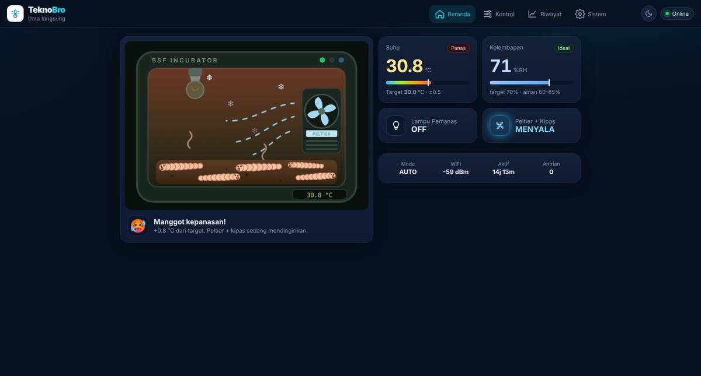
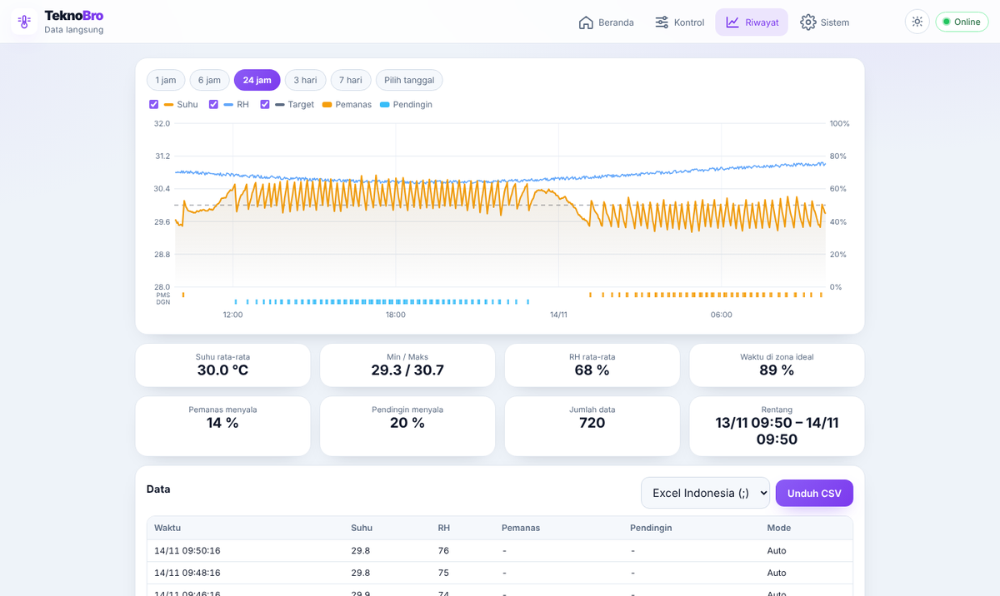

### Tema
Buka **Sistem › Tampilan**:
* Warna: **Biru** (bawaan), **Merah**, **Hijau**, **Ungu**
* Mode: **Gelap**, **Terang**, **Otomatis** (mengikuti pengaturan HP/laptop)
* Tombol bulan/matahari di kanan atas untuk ganti gelap/terang cepat

Pilihan tema disimpan di masing-masing perangkat.

| Boot | Login | Beranda | Pemanas menyala |
|---|---|---|---|
| 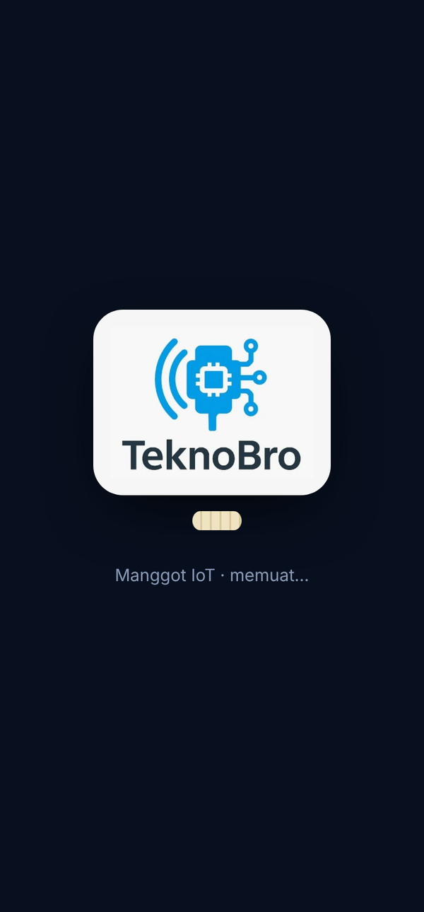 | 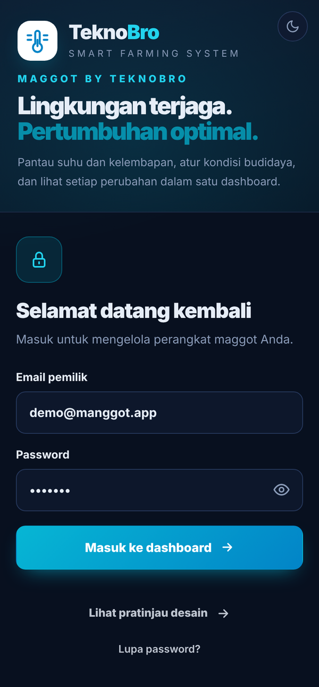 |  |  |

| Kontrol | Riwayat | Sistem |
|---|---|---|
| 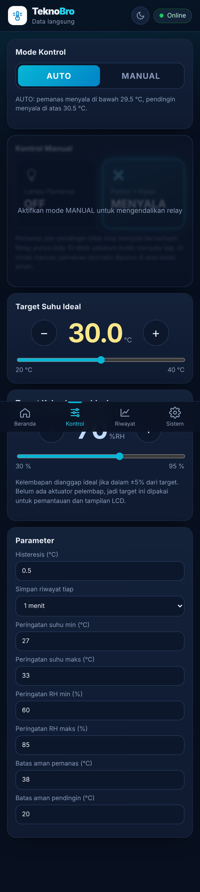 | 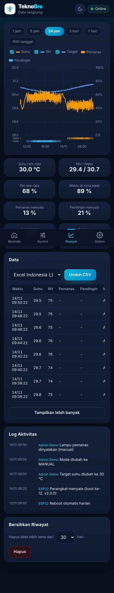 |  |

Animasi manggot di Beranda mengikuti kondisi:
* **Nyaman**: manggot tersenyum dan merayap pelan.
* **Kepanasan**: manggot kemerahan, berkeringat, menggeliat cepat, ada uap panas.
* **Kedinginan**: manggot kebiruan, menggigil, ada embun beku.
* **Offline / sensor error**: manggot tidur (Zzz).
* **Lampu menyala**: bohlam bersinar dengan gelombang panas. **Pendingin menyala**: kipas berputar dengan aliran udara dingin.

Gambar di atas diambil dari mode demo (data simulasi).

---

## 5. Tampilan LCD 20x4

| Baris | Isi |
|---|---|
| 1 | Hari, tanggal, jam, `A`/`M` (mode AUTO/MANUAL), ikon WiFi |
| 2 dan 3 | Halaman bergantian: Suhu, Kelembapan, Target, Waktu, WiFi, Aktuator, Cloud. Saat ada peringatan, halaman peringatan berkedip |
| 4 | Status aksi: PENDINGIN MENYALA, PEMANAS MENYALA, SUHU STABIL, MODE MANUAL, BATAS AMAN AKTIF, atau SENSOR ERROR |

Saat booting, LCD menampilkan animasi judul, tulisan **by TeknoBro**, lalu cek LCD, memori, SHT30, WiFi, waktu, dan login cloud.

---

## 6. Struktur folder

```
manggot-iot/
├── index.html, style.css, app.js        aplikasi (web dan isi APK)
├── firebase-config.js                    config Firebase + DEVICE_ID + SITE_URL
├── manifest.json, sw.js, icons/          ikon dan logo TeknoBro
├── esp32/inkubator_manggot_iot/          program ESP32 untuk Arduino IDE (.ino + secrets.example.h)
├── platformio/                           program ESP32 untuk VS Code + PlatformIO
├── wokwi/                                diagram.json, sketch.ino, chip SHT30, libraries.txt
├── firebase/database.rules.json          aturan keamanan database
├── firmware/                             manggot.bin + version.json (OTA dari GitHub)
├── android-build/                        konfigurasi Capacitor, ikon, splash, keystore
├── docs/                                 skematik, arsitektur, screenshot
├── tools/                                skrip PowerShell
├── build-apk.bat                         build APK di laptop
├── publish.bat                           upload ke GitHub
├── update-semua.bat                      upload GitHub + build APK
└── upload-ptrfarhan.bat / setup-github.bat   setup awal GitHub
```

File `secrets.h` (password WiFi dan akun ESP32) **tidak ikut ter-upload** ke GitHub.

---

## 7. Setup Firebase

1. Buat project di https://console.firebase.google.com (paket Spark, gratis).
2. **Security › Authentication** › Get started › aktifkan **Email/Password**.
3. Tab **Users** › Add user, buat dua akun:
   * akun kamu (otomatis menjadi admin saat pertama login di aplikasi)
   * `esp32@manggot.app` untuk perangkat
4. **Databases & Storage › Realtime Database** › Create Database › Singapore › locked mode.
5. Tab **Rules** › tempel isi `firebase/database.rules.json` › **Publish**.
6. **Project Overview › Add app › Web**, salin config ke `firebase-config.js`.
7. Isi `esp32/inkubator_manggot_iot/secrets.h` (salin dari `secrets.example.h`).

---

## 8. Upload program ESP32

1. Arduino IDE, Boards Manager: **esp32 by Espressif** versi 3.x.
2. Library Manager: **LiquidCrystal I2C** (Frank de Brabander) dan **ArduinoJson** (Benoit Blanchon) versi 7.
3. Tools: Board **ESP32 Dev Module**, Partition Scheme **Minimal SPIFFS (1.9MB APP with OTA/190KB SPIFFS)**.
4. Upload, lalu buka Serial Monitor 115200 baud. Harus muncul `[CLOUD] Login Firebase OK`.

Hotspot HP untuk ESP32 harus memakai pita **2,4 GHz**.

---

### Versi PlatformIO
Folder `platformio/` berisi program yang sama untuk **VS Code + PlatformIO**:
1. Salin `platformio/include/secrets.example.h` menjadi `secrets.h`, lalu isi.
2. VS Code › Open Folder › `platformio`.
3. PlatformIO › **esp32dev › Upload**. Environment `wokwi` untuk simulasi.
4. Setiap Build, file siap OTA muncul di `platformio/bin/manggot-v<versi>.bin`.

Detail ada di `platformio/README.md`.

## 9. Build aplikasi Android (APK)

Klik dua kali **`build-apk.bat`**. Pertama kali, file ini memasang Node.js, Java 17, dan Android SDK (sekitar 1 GB, 10 sampai 20 menit). Berikutnya sekitar 1 menit.

Hasilnya `manggot-iot.apk` di folder proyek. Kirim ke HP lalu instal. Jika HP tersambung USB dengan USB debugging aktif, APK langsung terpasang otomatis.

---

## 10. Publish ke GitHub (sekali klik)

Klik dua kali **`publish.bat`**. Semua file proyek, termasuk dokumentasi, skematik, dan screenshot, ter-upload ke repo. Web otomatis aktif di **https://ptrfarhan.github.io/manggot-iot/**.

`update-semua.bat` menjalankan publish lalu build APK sekaligus.

---

## 11. Update firmware (OTA)

**Cara utama, dari file:**
1. Naikkan `#define FW_VERSION` di `.ino`.
2. Arduino IDE › **Sketch › Export Compiled Binary**, lalu ambil file `.ino.bin` (bukan bootloader, partitions, atau merged).
3. Aplikasi › **Sistem › Update Firmware** › pilih file › isi versi › **Kirim & update**.
4. LCD menampilkan progres, lalu ESP32 restart sendiri.

**Cara lain:** jalankan `publish.bat` (file `.bin` otomatis masuk folder `firmware/`), lalu klik **Update ke vX** di aplikasi. Atau buka `http://IP-ESP32/` dan upload `.bin` di halaman lokal.

---

## 12. Simulasi Wokwi

1. Buka https://wokwi.com/projects/new/esp32.
2. Ganti `sketch.ino` dan `diagram.json` dengan isi folder `wokwi/`.
3. Tambah file `libraries.txt`, `sht30.chip.json`, `sht30.chip.c`, dan `secrets.h` (isi data Firebase, WiFi `Wokwi-GUEST`).
4. Klik **Play**. Klik chip SHT30 untuk menggeser suhu dan kelembapan. LED kuning = lampu, LED biru = peltier + kipas.

Sensor SHT30 di Wokwi dibuat sebagai chip kustom, jadi kode simulasi sama dengan program asli (hanya `WOKWI_SIM 1`).

---

## 13. Perintah Serial

115200 baud, akhir baris Newline.

| Perintah | Fungsi |
|---|---|
| `SET 31` | ubah target suhu (20 sampai 40 °C) |
| `MODE AUTO` / `MODE MANUAL` | ubah mode |
| `HEAT ON` / `HEAT OFF` | pemanas (mode manual) |
| `COOL ON` / `COOL OFF` | pendingin (mode manual) |
| `RELAY SWAP` / `RELAY NORMAL` | tukar relay atau kembalikan |
| `RELAY HIGH` / `RELAY LOW` | polaritas modul relay |
| `WIFI LIST` | daftar WiFi tersimpan |
| `WIFI ADD nama;password` | tambah WiFi |
| `WIFI DEL 2` | hapus WiFi nomor 2 |
| `REBOOT` | restart |
| `STATUS` | tampilkan status |
| `HELP` | daftar perintah |

---

## 14. Struktur database

```
users/{uid}            name, email, role ("admin" | "operator")
devices/manggot01/
  status               t, h, ok, cool, heat, mode, al, sf, rssi, ssid, ip, up, fw, q, ap, boot, heap, seen, ota{st,msg,p}
  config               mode, sp, hy, hsp, wtl, wth, whl, whh, smax, smin, mc, mh, hs
  system               wifi[{s,p}], rbEn, rbMode, rbHours, rbAt, rlSwap, rlHigh, rebootReq, ota{src,url,size,n,ver,req}
  history              t<epoch>: { t, h, f, a }   f: 1 pendingin, 2 pemanas, 4 manual, 16 sensor ok
  events               { ts, u, m }   log aktivitas
  otabin               potongan file firmware sementara (dihapus setelah update)
```

---

## 15. Masalah umum

| Gejala | Solusi |
|---|---|
| Aplikasi: "Akses ditolak" | Tempel ulang `firebase/database.rules.json` di Firebase › Rules › Publish |
| Serial: `Login Firebase gagal` | Cocokkan email/password `esp32@manggot.app` di `secrets.h` dengan Authentication |
| ESP32 tidak tersambung WiFi | Gunakan pita 2,4 GHz. Cek daftar WiFi di aplikasi atau `WIFI LIST` |
| Lampu dan peltier terbalik | Sistem › Pengaturan Relay › Tukar relay |
| Relay menyala saat seharusnya mati | Sistem › Pengaturan Relay › ubah jenis modul (Active LOW/HIGH) |
| Update firmware gagal: ruang flash | Partition Scheme harus Minimal SPIFFS |
| Aplikasi tetap mode demo | `apiKey` di `firebase-config.js` belum diisi |

---

<p align="center">
  <br>
  <sub>Manggot IoT · TeknoBro</sub>
</p>
